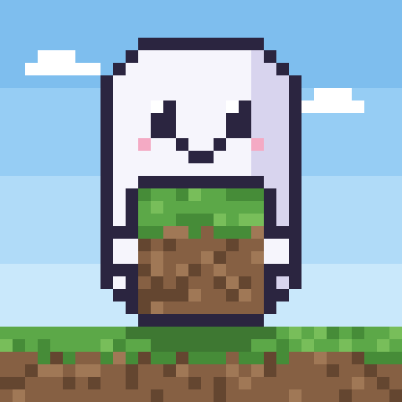

# Boo Blocks

Build a block world together, live in a [Ghostly](https://github.com/MiguelMedeiros/ghostly) chat. Open Boo Blocks in a
1:1 chat and your contact gets a card to join: you walk, fly, break and place blocks in one world, see each other as
little ghosts with your names, and the world is kept for that chat on both sides. What one of you builds while the
other is away reaches them the next time you are both in.

Boo Blocks is a Ghostly mini-app ([WISP 1200](https://github.com/MiguelMedeiros/ghostly/blob/dev/docs/wisps/1200-marketplace.md)):
one self-contained HTML file (about 60 KiB) that runs in the client's sandbox, and its icon. It has no network and talks to Ghostly
only through `window.ghostly`, the broker: `apps/1` frames of at most 32 KiB to the same app on the contact's side,
and storage per app and per chat. Its permissions are `chat` and `name`; its `view` is `full`.

## How it works

- **Drawing:** plain WebGL 2, no library: a mesh per 16³ section with face shading, ambient occlusion and fog, the
  contact's ghost, the outline of the block pointed at. The block textures are drawn by code into an atlas at start
  (`src/render/atlas.ts`); the sounds are synthesized with Web Audio (`src/sound.ts`). No asset file, nobody else's
  art. Frames are drawn only when something on screen changes.
- **Controls:** the runner's sandbox has no `allow-pointer-lock`, so the mouse is never captured: drag to look,
  WASD to walk, Space to jump (or swim, or fly up), Shift to fly down, F to fly, click to break the block under the
  cursor, right-click to place, 1–9 or the wheel for the block, arrows to turn, Q and E to break and place at the
  centre. Touch screens get arrows, jump, fly and a break/place switch; tap acts, drag looks.
- **The world:** the ground from a seed (integer-only noise, the same bytes in every engine), plus the cells people
  changed, each with a Lamport clock: the higher clock wins, so both sides merge to the same world in any order. Only
  the edits are stored (pages under 64 KiB, at most 400,000 cells, under 5 MiB) and sent. On every open both sides
  swap a hash per section and send the sections that differ. See [docs/protocol.md](docs/protocol.md).
- **The broker's rate:** every call (storage and frames) goes through one limiter under 40 a second, frames first.

## Build

Node 22 or later.

```sh
npm ci
npm run typecheck
npm test               # the world, merging, storage, sync between two sides on a mock broker, physics, the bundle
npm run build          # dist/index.html, the whole app in one file
npm run dev            # a dev server; outside Ghostly it runs alone on a stand-in broker that keeps nothing
npm run test:browser   # the built page in Chromium and WebKit (npx playwright install chromium webkit once)
```

`npm run test:browser` runs the page inside `<iframe sandbox="allow-scripts">` under a CSP like the web runner's:
the ground is the same as Node's in Chromium and WebKit, there is no CSP violation, the mouse breaks and places
blocks that are still there after a reload, and two sides build at once, see each other's name, and find the world
again after reloading and after one leaves while the other builds. Chromium draws with SwiftShader, so it needs no
GPU; a WebKit without WebGL 2 (some Linux machines) skips the specs that draw.

[test/ghostly-e2e/](test/ghostly-e2e/) runs the built Boo Blocks inside a real Ghostly web client, two peers in one
chat, on Ghostly's own e2e harness.

`npm run digest` prints the built file's SHA-256 in the form a signed bundle lists it. The build is reproducible;
the bundler is pinned (`overrides` in `package.json`).

### Checked by hand

Before a release, check these and tick them, with the client versions, in the release's pull request or issue:

- **Desktop (macOS, WKWebView):** Boo Blocks opens in its window, draws, drag looks, keys move, both mouse buttons build,
  and a contact on the web sees the edits and the ghost.
- **Sounds:** after a click inside the frame, breaking, placing and footsteps are heard on web and Desktop.
- **Touch (iOS Safari, Android Chrome):** drag looks without scrolling the page, arrows walk, tap breaks or places as
  the switch says.
- **Performance:** a laptop without a fast GPU keeps the world smooth while walking.

| Path | What it is |
|---|---|
| `src/terrain.ts` | The ground from a seed: integer hashing, value noise, beaches, snow, trees |
| `src/world.ts` | The world: the edits with their stamps, the merge rule, sections and their hashes |
| `src/codec.ts` | Edits as base64url records, for frames and storage |
| `src/protocol.ts` | The frames, and the checks on what a contact sends (untrusted) |
| `src/sync.ts` | Hello, catching up by section, ticks |
| `src/store.ts` | The world in the app's storage, in pages |
| `src/limiter.ts` | One budget for every broker call |
| `src/core.ts` | The world, storage and session wired together (no drawing) |
| `src/player.ts`, `src/raycast.ts` | Walking, jumping, swimming, flying; which block is pointed at |
| `src/render/` | The renderer, the mesher, the drawn atlas, the matrices |
| `src/ui.ts`, `src/style.css`, `src/strings.ts` | The page around the world, in English and Brazilian Portuguese |
| `src/sound.ts` | Sounds synthesized with Web Audio |
| `src/main.ts` | The page: input, the loop, the contact's ghost |
| `src/vendor/miniApp.ts` | The broker's types and limits, copied from Ghostly (see its header) |
| `test/mockBroker.ts` | A broker with the WISP's rules, rate limit included, for two sides of one chat |
| `test/browser/` | Playwright specs and their two-page harness with a test broker |
| `test/ghostly-e2e/` | The spec that runs Boo Blocks in Ghostly's own e2e suite |
| `ghostly-app.json` | The manifest, without `publisher`, `sequence` and `files` (the CLI writes those) |
| `assets/icon.png`, `scripts/icon.mjs` | The icon (512 x 512, a ghost holding a grass block), drawn by code: `npm run gen:icon` writes it, and `test/icon.test.ts` checks the committed file is the script's output |
| `scripts/stage.mjs`, `scripts/bundle.mjs` | `npm run stage`: the folder `ghostly app publish` signs. `npm run check:bundle`: whether a signed bundle is this build, and the store's listing for it |
| `CHANGES.md`, `docs/PUBLISHING.md`, `docs/protocol.md` | What each version changed, how a version is published, the protocol |

## Publish a new version

Only the holder of the Boo Blocks publisher key can sign a version. [docs/PUBLISHING.md](docs/PUBLISHING.md) has every
step: prepare the version, build and stage, sign with `ghostly app publish`, commit `app.ghostlyapp` here, list it in
the store and sign the store's index.

## License

MIT, see [LICENSE](LICENSE). Everything in the built file and the icon is this repository's own: no third-party
code, the textures and the icon are drawn by code and the sounds synthesized.
